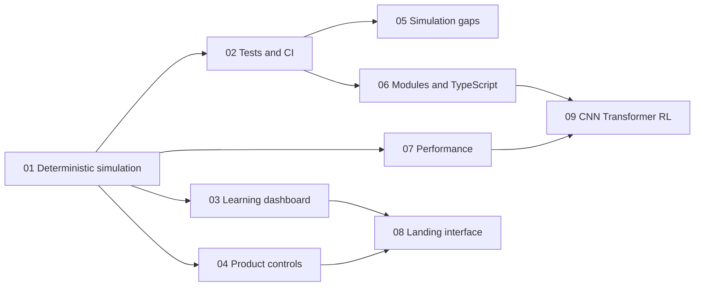

# Roadmap

The order matters more than the list. Each step makes the next one cheaper.

1. **[[01 Deterministic simulation]] and [[02 Tests and CI]] together.** Without a repeatable run there is nothing to test against, and without tests every later change is a guess.
2. **[[08 Landing interface]].** Being built now. It brings the visible half of cards 03 and 04 with it: the fitness chart, speed and pause, the scenario list and the explanation panel.
3. **[[03 Learning dashboard]] and [[04 Product controls and explanations]].** Finish what the interface started: experiments with a fixed seed, the manual driving mode.
4. **[[05 Close the simulation gaps]].** One gap at a time, each with a test written first.
5. **[[06 Modules and TypeScript]].** Only once the tests can prove the behaviour did not change.
6. **[[07 Performance and Web Worker]].** Profile first.
7. **[[09 CNN Transformer RL brain]].** A research track. Keep the current network as the baseline to beat.

> [!note] What is still unverified
> The simulation has been checked in a headless Node harness. Card 08 is the first work that gets looked at in a real browser.
